# Technical Architecture Map: `src/store/dailyBudgetStore.ts`

> [!NOTE]
> **Architecture & Modular Decomposition (October 2026)**
> `src/store/dailyBudgetStore.ts` serves as the public facade (875 lines) delegating to focused submodules under `src/store/dailyBudget/`:
> - Types & Interfaces: `src/store/dailyBudget/types.ts`
> - Offline Pending Storage: `src/store/dailyBudget/pendingStorage.ts`
> - Cross-Store Expense Bridge: `src/store/dailyBudget/expenseBridge.ts`
> - Category Map Classifiers: `src/store/dailyBudget/classifiers.ts`
> - Metrics & Waterfall: `src/store/dailyBudget/metrics.ts`
> - Rollover Engine: `src/store/dailyBudget/rollover.ts`
> - Supabase Hydration Coordinator: `src/store/dailyBudget/hydrate.ts`
> - Database Anomaly Self-Healing: `src/store/dailyBudget/selfHealing.ts`
> - Plan Actions & Cadence Settings: `src/store/dailyBudget/planActions.ts`
> For system architecture, see [`docs/architecture.md §6`](../architecture.md) and [`docs/adr/0013-store-module-split.md`](../adr/0013-store-module-split.md). For live calculation helpers, see [`src/lib/budgetCalculations.ts`](file:///d:/Arthik-App/src/lib/budgetCalculations.ts) and [`src/lib/budgetUtils.ts`](file:///d:/Arthik-App/src/lib/budgetUtils.ts).

This document catalogs the functions of `dailyBudgetStore` and its sub-modules under `src/store/dailyBudget/`. It adheres strictly to the domain vocabulary defined in [CONTEXT.md](file:///d:/Arthik-App/CONTEXT.md).

---

## 1. Inventory of Functions & Module Map

Every function and helper associated with `src/store/dailyBudgetStore.ts` is catalogued below by its canonical implementation module:

| # | Function / Export | Canonical Implementation Module | Category | Description |
|---|---|---|---|---|
| 1 | `registerExpenseGetter`, `getCurrentExpenses` | `src/store/dailyBudget/expenseBridge.ts` | **CROSS-STORE** | Bridge callbacks linking `expenseStore` data to budget calculations without circular imports. |
| 2 | `buildCategoryClassifier`, `buildEligibleIncomeClassifier` | `src/store/dailyBudget/classifiers.ts` | **CROSS-STORE** | In-memory Category map classifiers delegating directly to `isIncomeTransaction(e, cat)`. |
| 3 | `getPendingSettingsKey`, `savePendingSettingsOffline`, `clearPendingSettingsOffline` | `src/store/dailyBudget/pendingStorage.ts` | **STORAGE** | AsyncStorage offline queues for pending budget, Gullak, and plan change mutations. |
| 4 | `getTodayDateStr`, `computeMetrics`, `runWaterfall`, balance selectors | `src/store/dailyBudget/metrics.ts` | **METRICS** | Local time date strings, waterfall calculations, carryable funds, and available income selectors. |
| 5 | `applyScheduledNextDayBudget`, `finalizeDailyRecords`, `finalizePeriods` | `src/store/dailyBudget/rollover.ts` | **ROLLOVER** | Midnight day evaluation, daily savings finalization, and weekly/monthly cycle rollovers. |
| 6 | `runHydrateFromSupabase`, `buildOfflineHydrationPatch` | `src/store/dailyBudget/hydrate.ts` | **HYDRATION** | Startup hydration coordinator, persist-hydration gate, offline fast-path, and remote fetching. |
| 7 | `selfHealDefaultBudget`, `selfHealCorruptedRows` | `src/store/dailyBudget/selfHealing.ts` | **SELF-HEALING** | Repairs OTA migration defaults (e.g. 500 budget) and corrupted savings log rows. |
| 8 | `handleSetDailyBudget`, `handleToggleAutoRenew`, `handleSetBudgetModeEnabled`, `handleCancelPendingPlanChange`, `resolvePendingPlanChange`, cadence switch handlers | `src/store/dailyBudget/planActions.ts` | **PLAN-ACTIONS** | Allowance updates, cadence switching, next-day scheduling (`PUR-003`), scheduled plan cancellation, and pending plan queues. |
| 9 | `getTodayRecord`, `getPastRecordsList` | `src/store/dailyBudgetStore.ts` | **STORE-READ** | Zustand selectors for today's record and filtered past daily records. |
| 10 | `addGullakDeposit`, `removeGullakDeposit`, `updateGullakDepositAmount`, `adjustGullakIncomeDeposits`, `syncPendingGullakDeposits` | `src/store/dailyBudgetStore.ts` | **STORAGE** | Gullak manual deposits management, income-deficit reconciliation adjustments, and offline queue synchronization. |
| 11 | `syncWithExpenses` | `src/store/dailyBudgetStore.ts` | **MIXED** | Recomputes today's live spent, checks 80%/100% notification thresholds, and invokes rollover. |
| 12 | `checkAndRollover` | `src/store/dailyBudgetStore.ts` | **FACADE** | Coordinates with `rollover.ts` (`runCheckAndRollover`) and updates store metrics. |
| 13 | `uploadPendingDailyRecords` | `src/store/dailyBudgetStore.ts` | **STORAGE** | Scans `dailyRecords` for `needsUpload === true` and upserts them to Supabase `daily_savings_log`. |
| 14 | `hydrateFromSupabase` | `src/store/dailyBudgetStore.ts` | **FACADE** | Coordinates with `hydrate.ts` (`runHydrateFromSupabase`) for complete store hydration. |
| 15 | `resetDailyBudget` | `src/store/dailyBudgetStore.ts` | **STORAGE** | Wipes local store state and AsyncStorage keys on user sign-out. |

> [!NOTE]
> **Extracted Pure Modules (`src/lib/budgetCalculations.ts`)**:
> `calculateSavingsMetrics`, `evaluateDayStatus`, `computeSpentByDate`, `computeSpentForDate`, `buildDefaultTodayRecord`, `filterPastRecords`, and `shouldIgnoreDuplicates` reside in `src/lib/budgetCalculations.ts` as pure, testable functions and are re-exported by `dailyBudgetStore.ts`.

---

## 2. The Rules, Stated Exactly

All rules below were extracted directly from the source code.

### 2.1 How a Day's Budget is Decided

A day's budget is derived according to three distinct tiers:

1. **Recurring Allowance (Base Daily Budget)**:
   - Configured via `setDailyBudget(amount)` in `src/store/dailyBudget/planActions.ts`.
   - Sanitized via `cleanAmount = Math.max(0, round2(amount))`.
   - User Preference Sovereignty: `willAutoRenew = cleanAmount > 0 ? currentAutoRenew : false`. Changing amount respects user's paused state and never autonomously forces `isAutoRenew = true`.
   - Applies automatically to any new day when `isAutoRenew` is `true`.
2. **Next-Day Scheduling (Day's Allowance Discipline)**:
   - Configured via `scheduleNextDailyBudget(amount)` / `handleScheduleNextDailyBudget`.
   - Sanitized via `cleanAmount = Math.max(0, round2(amount))`.
   - To preserve strict financial discipline and the Real-Money Invariant, budget allowance adjustments take effect starting tomorrow at 12:00 AM (`effectiveFrom = tomorrowStr`) via `budget_plan_changes` rather than abruptly mutating today's active spending allowance mid-day.
3. **Day Where the User Set Nothing (Unset / Fresh Day)**:
   - In `getTodayRecord()` (lines 253–254): If no record exists in `dailyRecords`, budget is `get().isAutoRenew ? get().dailyBudgetAmount : 0`. If `isAutoRenew` is `false`, budget is strictly `0`.
   - In `syncWithExpenses()` (line 446): If `!todayRecord`, budget is `get().isAutoRenew && get().dailyBudgetAmount > 0 ? get().dailyBudgetAmount : 0`.
   - In `hydrateFromSupabase()` (lines 1077, 1086–1089): If `!records[todayStr]`, budget is `resolvedAutoRenew && resolvedBudget > 0 ? resolvedBudget : 0`. If a record exists but has `budget === 0` while `isFinalized === false` and `resolvedAutoRenew === true`, it is updated to `resolvedBudget`.
   - In `checkAndRollover()` for historical days without records (lines 613–626):
     ```ts
     615: if (get().isAutoRenew && get().dailyBudgetAmount > 0) {
     616:   budget = get().dailyBudgetAmount;
     617:   saved = Math.max(0, budget - spent);
     618:   status = spent > budget ? 'missed' : saved > 0 ? 'saved' : 'even';
     619: } else if (spent > 0) {
     620:   status = 'unknown';
     621:   budget = 0;
     622:   saved = 0;
     623: } else {
     624:   // No prior record, 0 budget, 0 spent: skip
     625:   continue;
     626: }
     ```
   - In `checkAndRollover()` for historical days with existing record having `budget === 0` (lines 628–638): If `isAutoRenew && dailyBudgetAmount > 0`, retroactively assigns `budget = dailyBudgetAmount`; otherwise, locks `status = 'unknown'`, `budget = 0`, `saved = 0`.

### 2.2 How "Spent" is Computed and Excluded Transactions

The computation of spent delegates to pure helpers `computeSpentForDate` and `computeSpentByDate` in `src/lib/budgetCalculations.ts` (lines 204–242) using `isIncomeFn = buildCategoryClassifier()`:

- In `syncWithExpenses` (lines 323–325):
  ```ts
  const isIncomeFn = buildCategoryClassifier();
  const todaySpent = computeSpentForDate(expenses, todayStr, isIncomeFn);
  ```
- In `checkAndRollover` (lines 430–433) and `hydrateFromSupabase` (lines 766–767):
  ```ts
  const isIncomeFn = buildCategoryClassifier();
  const spentByDate = computeSpentByDate(expenses, isIncomeFn);
  ```

Inside `computeSpentForDate` and `computeSpentByDate`, each expense is inspected via the extracted predicate `extractDateAndAmount(e, isIncomeFn)`:
```ts
const isIncome = isIncomeFn ? isIncomeFn(e) : isIncomeTransaction(e);
if (isIncome) return null;
const cleanDate = e.expense_date?.split('T')[0]?.trim();
if (!cleanDate) return null;
const amount = Number(e.amount) || 0;
```

**Excluded Transactions**:
1. **Income Transactions**: Excluded if `isIncomeFn(e)` evaluates to `true`, which uses `buildCategoryClassifier()` (lines 22–32) to look up the transaction's category from `useCategoryStore` and delegate directly to `isIncomeTransaction(e, cat)` (checks explicit `type` first, then category name keywords).
2. **Date Mismatches**: Excluded if `cleanDate !== targetDate`.
3. **Pre-Registration Transactions**:
   - In `calculateSavingsMetrics` (lines 40–43): `if (userCreatedAt && r.date < userCreatedAt) return;`
   - In `checkAndRollover` (lines 452–460): Any record where `d < userCreatedAtStr` is purged from state via `delete records[d]` and skipped.
   - In `hydrateFromSupabase` (line 778): Any log entry where `d < userCreatedAtStr` is ignored.
4. **Invalid Amounts**: Transactions with `NaN` or non-numeric amounts resolve to `0` via `Number(e.amount) || 0`.

### 2.3 How "Saved" is Computed

- **For Active / Today Records**:
  - Formula: `saved = Math.max(0, budget - spent)` (lines 177, 234, 287, 312, 336, 352).
  - Unspent allowance is calculated in real time. If `spent >= budget`, `saved` is `0`.
- **For Finalized Past Days**:
  - In `checkAndRollover` (lines 500, 510) via `evaluateDayStatus(budget, spent)`: `saved = Math.max(0, budget - spent)`.
  - If `status === 'unknown'`: `saved = 0`.
  - In `hydrateFromSupabase` (lines 847–853) via `evaluateDayStatus(dayBudget, daySpent, 'unknown')`:
    - If `dayBudget <= 0`: `daySaved = 0`, `status = 'unknown'`.
    - If `dayBudget > 0`: `daySaved = Math.max(0, dayBudget - daySpent)`.

### 2.4 When a Day Becomes Finalized and What Triggers It

- **Definition of Finalized**: `DailyRecord.isFinalized === true`. The day's metrics are permanently frozen and queued for remote sync to `daily_savings_log` (`needsUpload: true`).
- **Condition for Finalization**: A day is finalized **only if it is strictly in the past** (`d < todayStr`). Today is **never** finalized (`isFinalized: false`, lines 178, 235, 282, 306, 337, 896).
- **Execution Triggers**:
  1. **At the end of `syncWithExpenses(expenses)`** (line 416): Called whenever an expense is added, edited, deleted, or refreshed.
  2. **In `hydrateFromSupabase(userId)`** (line 935): Called upon user authentication or refresh.
- **Roll-over Workflow (`checkAndRollover`)**:
  - Scans all past dates (`pastDates = new Set(...)`, lines 436–449) derived from existing `dailyRecords` keys `< todayStr` unioned with all expense dates `< todayStr`.
  - For each date `d >= userCreatedAtStr`, if any metric changed or `!existing.isFinalized`, sets `isFinalized: true`, `needsUpload: true`, and triggers an asynchronous upsert to Supabase `daily_savings_log` (lines 550–563) with `ignoreDuplicates: shouldIgnoreDuplicates(status)`.

### 2.5 How Each Status is Chosen

1. **Active (`status: 'active'`)**:
   - Chosen exclusively for **today** when `todaySpent <= budget || budget === 0` (lines 179, 236, 283, 307, 338, 897).
   - If `budget === 0`, today remains `'active'` even if `todaySpent > 0`.
2. **Missed (`status: 'missed'`)**:
   - For today: when `todaySpent > budget && budget > 0` (lines 184, 236, 288, 313, 338, 345).
   - For past days: in `checkAndRollover` and `hydrateFromSupabase` via `evaluateDayStatus`, when `spent > budget && budget > 0`.
3. **Saved (`status: 'saved'`)**:
   - For finalized past days where `budget > 0`, `spent <= budget`, and `saved > 0` (via `evaluateDayStatus`).
4. **Even (`status: 'even'`)**:
   - For finalized past days where `budget > 0`, `spent === budget`, and `saved === 0` (via `evaluateDayStatus`).
5. **Unknown (`status: 'unknown'`)**:
   - Past days where no budget was allocated (`budget === 0`) and `spent === 0` or `spent > 0` (via `evaluateDayStatus(budget, spent, 'unknown')`).
   - Uniformly assigned in both `checkAndRollover` (line 500) and `hydrateFromSupabase` (line 849), preserving user streaks across untracked days (Ticket 03 resolved).

> [!IMPORTANT]
> **Resolution of Past Discrepancies**:
> - **Code and `schema.sql` agree (canonical `BUD-008`)**: both use `'saved' | 'missed' | 'even' | 'unknown'` (the TypeScript-only `'active'` marks today while it is in progress and is never saved). There is no `'exceeded'` status and no translation layer; old cached days stored as `'exceeded'` are read as `'missed'` (`src/store/dailyBudget/legacyStatus.ts`, store persist version 4).
> - **Status 'unknown' Uniformity (Ticket 03)**: The former discrepancy where `hydrateFromSupabase` assigned `'even'` to zero-budget zero-spend days has been resolved. Both `checkAndRollover` and `hydrateFromSupabase` now evaluate zero-budget zero-spend days as `'unknown'`, preventing untracked days from breaking streaks.
> - **Upsert Duplication Safeguard (Ticket 02)**: In `checkAndRollover` (line 546), `isInsertOnly` is now governed by `shouldIgnoreDuplicates(status)` (`status === 'unknown'`), ensuring that first-time finalization of tracked days (`'saved'`, `'exceeded'`, `'even'`) genuinely overwrites remote records in `daily_savings_log`.

### 2.6 How the Streak is Computed

The savings streak is computed by `calculateSavingsMetrics` (lines 80–102):

```ts
80:  let streak = 0;
81:  let dayCheck = subDays(new Date(), 1);
82:  while (true) {
83:    const dStr = format(dayCheck, 'yyyy-MM-dd');
84:    if (userCreatedAt && dStr < userCreatedAt) {
85:      break;
86:    }
87:    const rec = records[dStr];
88:    if (rec && rec.isFinalized) {
89:      // 'unknown' days neither extend nor break the streak: skip and continue checking earlier days
90:      if (rec.status === 'unknown') {
91:        dayCheck = subDays(dayCheck, 1);
92:        continue;
93:      }
94:      if (rec.status === 'saved' && (rec.saved || 0) > 0) {
95:        streak++;
96:        dayCheck = subDays(dayCheck, 1);
97:        continue;
98:      }
99:    }
100:   // Any other status (missed, even, active, or missing unfinalized day) breaks the streak
101:   break;
102: }
```

- **What Extends the Streak**: Only a finalized past day with `rec.status === 'saved'` and `rec.saved > 0` (lines 94–98).
- **What Breaks the Streak**:
  - `status === 'missed'`
  - `status === 'even'`
  - `status === 'active'` (an unfinalized past record)
  - Missing day in `records` (`!rec`)
  - Unfinalized day (`!rec.isFinalized`)
  - Reaching registration boundary (`dStr < userCreatedAt`) terminates evaluation cleanly.
- **What is Neutral**: `rec.status === 'unknown'` (lines 90–93). It advances `dayCheck` by 1 without incrementing `streak` and without breaking the loop.
- **Streak Guards & Best Streak**:
  - Lines 167–175: If `confirmedSavedDays === 0`, `streak = 0` and `maxStreak = 0`. If `streak > confirmedSavedDays`, `streak = confirmedSavedDays`. `finalizedSavedRecords` filters out pre-registration days (`(!userCreatedAt || r.date >= userCreatedAt)`), preventing pre-registration streaks from bleeding into `bestStreak`.
  - Best streak gap bridging: Identifies the longest contiguous sequence of saved records in historical order, treating intermediate days as neutral bridges only if explicitly recorded with `status === 'unknown'`.

### 2.7 How `totalAccumulatedSavings` is Computed

Total accumulated savings (Gullak) is computed in `calculateSavingsMetrics` in `src/lib/budgetCalculations.ts` using the Money Waterfall (ADR 0012):

```ts
// 1. Sum up finalized past savings (post-registration)
if (r.status === 'saved' || (r.saved || 0) > 0) {
  totalSaved += (r.saved || 0);
} else if (r.budget > 0 && r.spent > r.budget) {
  pastOverspent += (r.spent - r.budget);
}

// 2. Overspend is shielded by available income first!
const todayGullakDeduction = Math.max(0, round2(todayLiveOverspent - Math.max(0, availableIncome)));

// 3. Waterfall override replaces naive pastOverspent + live deduction
const gullakDrawn = gullakDrawnOverride !== undefined
  ? Math.max(0, gullakDrawnOverride)
  : pastOverspent + todayGullakDeduction;

// 4. Manual Gullak deposits added; net savings floored at 0 and capped at totalAccountRemaining
let netSavings = Math.max(0, round2(totalSaved - gullakDrawn + manualDeposits));
if (totalAccountRemaining !== undefined) {
  netSavings = Math.min(netSavings, Math.max(0, round2(totalAccountRemaining)));
}
```

- **Inclusion of Past Savings (Multi-Cadence)**: 
  - **Daily Users**: Sum of all `r.saved` from finalized past days (`r.isFinalized && r.date < todayStr && r.date >= userCreatedAt`).
  - **Weekly Users**: Unspent balance from completed calendar weeks (Monday 00:00 to Sunday 23:59:59) is evaluated by `buildPeriodsToFinalize` and rolled over into Gullak on Sunday midnight.
  - **Monthly Users**: Unspent balance from completed calendar months (1st to month-end 23:59:59) rolls over into Gullak on the month's final midnight.
- **Money Waterfall Shielding Across All Cadences (ADR 0012)**: Overspending against the active cadence pool (Daily, Weekly, or Monthly) draws from available income first before penalizing Gullak savings. If income covers the overspend, Gullak remains 100% intact.
- **Manual Gullak Deposits & All-Time Inflow**: User deposits into Gullak (`manualDeposits` from `gullak_deposits`) are credited directly to the reserve balance. For `'external'` deposits (fresh cash, gifts, bonus), funds are treated as real incoming money and simultaneously added to period and All-time Inflow ('All' view).
- **Floor and Account Cap**: Net accumulated savings cannot drop below zero, nor exceed `totalAccountRemaining`.

### 2.4 Carry-Forward Engine (CAR-001) Functions & Architecture
- `dailyCarryForDate(changes, getBudgetForDate, targetDailyBudget, dateStr)`: Pure daily allocation carry breakdown.
- `dailyCarryRemaining(changes, getBudgetForDate, targetDailyBudget, dateStr)`: Pure daily allocation carry remaining after dateStr.
- `periodCarryForPeriod(changes, periodStart)`: CAR-001 Mode B recursive multi-period drawdown for weekly and monthly plans. Returns `{ funded, toAdd, remainingAfter, base }` or `null`.
- `periodCarryRemaining(changes, dateStr)`: CAR-001 Mode B allocation carry remaining at end of dateStr across future periods.
- `carryForPeriod(plan, periodStart)`: Additive carry mode helper (adds once to the first period only).
- `getCarryableAmount()` (`src/store/dailyBudget/metrics.ts`): Evaluates real unspent money that can be carried into a new plan, including `poolLeft + periodCarryRemaining(plans, todayStr)`.
- `computeAllTimeBudget()` (`src/store/dailyBudget/metrics.ts`): Incorporates `dailyCarryRemaining` and `periodCarryRemaining` into the all-time budget pool, so carried money is not new money: the account total stays flat across a daily, weekly or monthly allocation switch.
- `calculatePeriodSummary()` (`src/lib/homeCalculations.ts`): Under `activeFilter === 'All'`, the carry-funded part of a budget period adds 0 to the All pill budget pool (`carryCover = pc.funded`: only the carry-funded part is left out; the gap part counts like any budget), guaranteeing zero double counting until real new money (gap or income) is deposited.

---

## 3. Date Boundaries & Timezone Sensitivities

The following table documents every location in the modular daily budget submodules (`src/store/dailyBudget/`) and calculations library (`src/lib/budgetCalculations.ts`) where dates are resolved, compared, or manipulated.

| Location | Code Snippet | Reference Time | Boundary & Timezone Consequence & Resolution |
|---|---|---|---|
| `src/store/dailyBudget/metrics.ts:47–57` | `getUserCreatedAtLocalDate(user?.created_at)` & `getUserCreatedAtStr()` | **Local Time via `parseISO`** | **Resolved (Ticket S3.1)**: Supabase stores `created_at` in UTC timestamp. Rather than naive `.split('T')[0]`, `getUserCreatedAtLocalDate` parses with `parseISO(createdAt)` and formats in the user's local timezone (`yyyy-MM-dd`). An Indian user (UTC+5:30) registering at 2:00 AM IST on Sept 19 correctly resolves to `'2026-09-19'` (not UTC `'2026-09-18'`), preventing pre-registration backdated transactions from corrupting active budget streaks and Gullak. |
| `src/lib/budgetCalculations.ts:58, 125`<br>`src/store/dailyBudget/rollover.ts:103` | `if (r.isFinalized && r.date < todayStr)` | **String Comparison** | Lexicographical date comparison. Safe assuming `'yyyy-MM-dd'`. Anchors finalization strictly to completed past days. |
| `src/lib/budgetCalculations.ts:81`<br>`src/store/dailyBudget/rollover.ts:131` | `subDays(today, 1)` | **Local Time** | Subtracts 1 day from current device clock. Crossing midnight shifts `dayCheck` by 1 day immediately upon next function invocation. |
| `src/lib/budgetCalculations.ts:138–154` | `parseISO(rec.date)`<br>`differenceInCalendarDays(cur, prev)`<br>`addDays(prevDate, step)` | **Calendar Date via `date-fns`** | **Resolved (Ticket S3.2)**: Replaced legacy `new Date(rec.date)` and `intermediateDate.setDate(prevDate.getDate() + step)` which parsed date strings at UTC midnight (causing backwards 1-day shifts and streak breaks in timezones west of UTC like EDT/PDT, as well as month-boundary bridging failures). Pure `date-fns` calendar day math is 100% immune to UTC offset drift, DST shifts, and calendar boundaries. |
| `src/store/dailyBudget/metrics.ts:45` | `format(new Date(), 'yyyy-MM-dd')` | **Local Time** | Baseline `getTodayDateStr()` generator. Anchors "today" to device local clock. |
| `src/lib/budgetCalculations.ts:196, 251` | `e.expense_date?.split('T')[0]?.trim()` | **Stored Date String** | Database column `expenses.expense_date` is Postgres `DATE NOT NULL` (stored and retrieved as `'yyyy-MM-dd'`). Splitting at `'T'` acts as defense-in-depth against ISO timestamp strings from legacy imports or mocks. |
| `src/store/dailyBudget/rollover.ts:131` | `format(subDays(new Date(), 1), 'yyyy-MM-dd')` | **Local Time** | Generates `yesterdayStr` based on device clock. |
| `src/lib/budgetCalculations.ts:498–505`<br>`src/store/dailyBudget/rollover.ts:284–297` | `shouldSendRolloverNotification(...)` | **Local Time** | Rollover notification only triggers for `yesterdayStr` (`params.date === params.yesterdayStr && params.saved > 0`). If a user does not open the app for 2–3 days, intermediate past days finalize silently into records without flooding the user with stale backdated notifications. |

### 3.1 Multi-Cadence Inactive Days & Rollover Guarantees
1. **Daily Cadence**:
   - Zero phantom history: Inactive days without transactions or pre-existing records are never artificially fabricated.
   - When a user opens the app after an absence, past days with recorded activity or existing records are finalized and locked into Gullak.
2. **Weekly Cadence**:
   - Weekly spending pools run Monday 00:00:00 to Sunday 23:59:59.
   - Even if the user does not open the app for several days mid-week, the pool remains active; unspent balance rolls over into Gullak on Sunday midnight upon the next sync.
3. **Monthly Cadence**:
   - Monthly spending pools run from the 1st to the final day of the calendar month.
   - Unspent balances roll over to Gullak on month-end midnight upon the next sync.
4. **Transaction Date Normalization**:
   - In `ExpenseFormScreen` and `useExpenseForm.ts:405`, manual expenses format user-selected dates via `format(selectedDate, 'yyyy-MM-dd')` in local device time.
   - In `autoLog/ledger.ts:70`, AutoLog transactions format `occurredAt` via `format(new Date(tx.occurredAt), 'yyyy-MM-dd')` in local device time.
   - Postgres `DATE` column guarantees date values are never modified by remote server UTC conversions.

---

## 4. The Income Inconsistency (Resolved)

### 4.1 Resolution of Dual-Engine Inconsistency
The dual-engine divergence between `paymentUtils.ts` and `dailyBudgetStore.ts` (documented in ADR 0007, superseded by ADR 0008) has been completely resolved.

`getIncomeCategoryIds` was deleted from `dailyBudgetStore.ts`. Both UI screens and the budget engine now standardize strictly on the shared helpers from `src/lib/incomeClassifier.ts` (`makeIncomeClassifier` and `makeEligibleIncomeClassifier`):

1. **Category Map Classifier Submodule (`src/store/dailyBudget/classifiers.ts:9–19`)**:
   ```ts
   export const buildCategoryClassifier = (): ((e: Expense) => boolean) => {
     return makeIncomeClassifier(useCategoryStore.getState().categories);
   };

   export const buildEligibleIncomeClassifier = (): ((e: Expense) => boolean) => {
     return makeEligibleIncomeClassifier(useCategoryStore.getState().categories);
   };
   ```
2. **Standardized Invocation Across Submodules**:
   - `planActions.ts:339`: in `refreshActiveDayBudget`
   - `metrics.ts:159, 195, 333, 343`: in `computeDailyMetrics`, `computeAllTimeBudget`, and `syncWithExpenses`
   - `rollover.ts:80`: in `computeFinancialsByDate`
   - `hydrate.ts:503`: in `hydrateFromSupabase`
   Passing `isIncomeFn` and `isEligibleIncomeFn` into pure calculation functions `computeSpentForDate`, `computeSpentByDate`, and `computeIncomeByDate`.

### 4.2 Startup Window Sequencing & Residual Risk

To close the failure window where categories were empty on cold start, startup initialization was resequenced into an authoritative hydration chain inside `src/screens/SplashScreen.tsx` (`initAuthAndNavigate`, step 4):

```ts
// Fixed startup hydration sequence for authenticated user:
// loadPendingExpenses -> fetchCategories -> (fetchExpenses + hydrateFromSupabase + appLock.init)
if (activeUser) {
  const hydrationChain = async () => {
    await useExpenseStore.getState().loadPendingExpenses();
    await fetchCategories();
    await Promise.all([
      fetchExpenses(),
      useDailyBudgetStore.getState().hydrateFromSupabase(activeUser.id),
      useAppLockStore.getState().init(activeUser.id),
    ]);
  };
  await Promise.race([
    hydrationChain(),
    new Promise<void>((resolve) => setTimeout(resolve, 5000)),
  ]);
  nextScreen = 'AppTabs';
}
```

**Residual Risk Analysis**:
1. **Online vs Offline Cold Start**: When online, `fetchCategories()` fetches fresh categories from Supabase. When offline, `categoryStore.fetchCategories` rehydrates cached categories from AsyncStorage (`@arthik_cached_categories_${userId}`), ensuring the category map is populated before expenses and budget logs are evaluated.
2. **Fresh Offline Install (Edge Case)**: The only scenario where categories remain empty is a brand-new, unauthenticated offline install where no cache exists. Because `session?.user?.id` is null on unauthenticated launch, neither `fetchExpenses` nor `hydrateFromSupabase` executes. As soon as a user authenticates, categories are fetched and cached first.
3. **Explicit Transaction Types**: All transactions created or modified in modern app versions write an explicit `type` column (`'expense' | 'income'`). Because `isIncomeTransaction` checks `item?.type === 'income'` and `item?.type === 'expense'` before category keywords, category lookup latency only affects legacy untyped rows (`type: undefined`).
4. **Multi-Cadence Equality (Daily, Weekly, Monthly)**: Across all cadences, eligible income is evaluated via `buildEligibleIncomeClassifier()` to filter out self-transfers, ensuring that external income properly shields the user's spending pool under ADR 0012 Money Waterfall before any overspend penalty touches Gullak.

### 4.3 Historical Worked Numerical Example (Pre-Fix vs Post-Fix)

**Scenario**:
- User has a Recurring Allowance of **₹500** (`dailyBudgetAmount: 500`, `isAutoRenew: true`).
- User's previous Gullak accumulated savings: **₹1,500**.
- User's current Savings Streak: **5 days**.
- Today, the user logs two transactions:
  1. Grocery shopping: **₹300**, `type: 'expense'`.
  2. Freelance consulting payout: **₹2,000**, `category_id: 'cat_freelance'` (Category name: "Freelance Work"), `type: undefined` (legacy/untyped row).

**Comparison of Behavior**:

| Metric | Screen Layer | Budget Engine (Pre-Fix) | Budget Engine (Post-Fix) |
|---|---|---|---|
| **Tx 2 Classification** | **Income** (`isIncomeTransaction`) | **Expense** (`incomeIds` was empty) | **Income** (`isIncomeTransaction(e, cat)`) |
| **Today's Spent** | **₹300** | **₹2,300** (+₹2,000 inflation) | **₹300** (Accurate) |
| **Today's Remaining / Saved** | **₹200** (`500 - 300`) | **₹0** (Savings eliminated) | **₹200** (`500 - 300`) |
| **Today's Status** | **Under Budget** (`active`) | **Exceeded** (False failure) | **Under Budget** (`active`) |
| **Overspend Penalty** | **₹0** | **₹1,800** penalty | **₹0** |
| **Gullak Reserve** | **₹1,500** intact | **₹0** (Wiped out) | **₹1,500** intact |
| **Savings Streak Tomorrow** | **6 days** (extended) | **0 days** (Streak broken) | **6 days** (Extended) |
| **Device Notifications** | None | **`🚨 Daily Allowance Exceeded!`** | None (No false alarm) |

---

## 5. What Depends on This File (Blast Radius)

The following components, screens, hooks, and stores import and depend on `dailyBudgetStore.ts`:

```mermaid
graph TD
    DBS["dailyBudgetStore.ts (Facade)"] --> SS["SavingsScreen.tsx"]
    DBS --> HS["HomeScreen.tsx"]
    DBS --> HIST["HistoryScreen.tsx"]
    DBS --> INS["InsightsScreen.tsx"]
    DBS --> PS["ProfileScreen.tsx"]
    DBS --> NS["NotificationsScreen.tsx"]
    DBS --> GDS["GullakDepositDetailScreen.tsx"]
    DBS --> SPLASH["SplashScreen.tsx"]
    DBS --> EDS["ExpenseDetailScreen.tsx"]
    DBS --> EFS["ExpenseFormScreen.tsx / useExpenseForm.ts"]
    DBS --> NAV["navigation/index.tsx & BottomNavBar.tsx"]
    DBS --> SCM["StreakCalendarModal.tsx"]
    DBS --> BEM["BudgetEditModal.tsx"]
    DBS --> DGM["DepositGullakModal.tsx"]
    DBS --> BHC["BrandedHeroCard.tsx"]
    DBS --> ES["expenseStore.ts & syncPending.ts"]
    DBS --> AL["features/autoLog/ledger.ts"]
    DBS --> AS["store/authStore.ts"]
    DBS --> HOOKS["useSavingsDashboard.ts"]
```



### 5.1 Consumers & Selectors

1. **`src/screens/SplashScreen.tsx` (`initAuthAndNavigate`, step 4)**:
   - Calls `useDailyBudgetStore.getState().hydrateFromSupabase(activeUser.id)` during startup hydration chain after categories are cached.
2. **`src/screens/HomeScreen.tsx`**:
   - `dailyBudgetAmount`, `isAutoRenew`, `totalAccumulatedSavings`, `getTodayRecord`, `dailyRecords`, `isBudgetModeEnabled`, `budgetCadence`
   - `syncWithExpenses`, `hydratedForUserId`, `hydrateFromSupabase`
3. **`src/screens/SavingsScreen.tsx`**:
   - `dailyBudgetAmount`, `isAutoRenew`, `totalAccumulatedSavings`, `savingsStreak`, `bestStreak`, `budgetCadence`, `budgetPlanChanges`
   - `setDailyBudget`, `toggleAutoRenew`, `setTodayBudget`, `addToTodayBudget`, `setBudgetCadence`, `cancelPendingPlanChange`
   - `syncWithExpenses`, `dailyRecords`, `getTodayRecord`, `getPastRecordsList`
4. **`src/screens/HistoryScreen.tsx`**:
   - Status badge styling, daily evaluation records, and timeline day badges.
5. **`src/screens/InsightsScreen.tsx`**:
   - Consumes period budget targets, cadence limits, and multi-period savings metrics.
6. **`src/screens/ProfileScreen.tsx`**:
   - Budget Mode toggle (`isBudgetModeEnabled`), cadence switching (`budgetCadence`), and allowance pausing (`PauseBudgetModal`).
7. **`src/screens/NotificationsScreen.tsx`**:
   - Budget threshold alert preferences, evening rollover nudges, and notification status sync.
8. **`src/screens/GullakDepositDetailScreen.tsx`**:
   - Manual Gullak deposits history, external inflow attribution, and deposit removal.
9. **`src/screens/ExpenseDetailScreen.tsx`**:
   - Invokes `useDailyBudgetStore.getState().syncWithExpenses(...)` on edit/delete.
10. **`src/screens/ExpenseFormScreen.tsx` & `src/hooks/useExpenseForm.ts`**:
    - Digital Vault Spending Guard balance checks and `useDailyBudgetStore.getState().syncWithExpenses(...)`.
11. **`src/navigation/index.tsx` & `src/components/BottomNavBar.tsx`**:
    - Selects `isBudgetModeEnabled` to dynamically switch between 4-tab (Pure Mode) and 5-tab (Budget Mode) layouts.
12. **`src/components/BrandedHeroCard.tsx`**:
    - Renders live allowance, Gullak balance, and unspent waterfall metrics.
13. **`src/components/StreakCalendarModal.tsx`**:
    - `savingsStreak`, `bestStreak`, `dailyRecords`, `bestStreakByCadence`.
14. **`src/components/BudgetEditModal.tsx` & `src/components/DepositGullakModal.tsx`**:
    - Mutates allowance amounts and registers manual Gullak deposits.
15. **`src/hooks/useSavingsDashboard.ts`**:
    - Encapsulates reactive dashboard selectors and cadence metrics. (The Money Waterfall is computed by `src/lib/moneyWaterfall.ts`, called directly by `HomeScreen`, `SavingsScreen`, `metrics.ts` and others; the unused `useMoneyWaterfall` hook was removed in OPT-50.)
16. **`src/store/expenseStore.ts` & `src/store/expense/syncPending.ts`**:
    - `registerExpenseGetter`, `syncWithExpenses(...)`, `uploadPendingDailyRecords()`.
17. **`src/features/autoLog/ledger.ts`**:
    - Synchronizes daily budget metrics and recalculates spent when background transactions are auto-logged.
18. **`src/store/authStore.ts`**:
    - Registered reset callback: `registerStoreResetCallback` (clears local budget state and storage keys on sign-out).

---

## 6. Extraction Status & Modular Inventory

The table below reflects the completed modular decomposition across all submodules adhering strictly to the **Facade Pattern Invariant** (`AGENTS.md` §6.1):

| Functionality / Domain Concept | Canonical Implementation Location | Status | Rationale & Safety |
|---|---|---|---|
| `evaluateDayStatus`, `calculateSavingsMetrics` | `src/lib/budgetCalculations.ts` | **EXTRACTED** | Pure mathematical aggregation and status determination. |
| `computeSpentByDate`, `computeSpentForDate` | `src/lib/budgetCalculations.ts` | **EXTRACTED** | Single-pass date grouping and single-date spending calculation using injected `isIncomeFn`. |
| `buildDefaultTodayRecord`, `filterPastRecords`, `shouldIgnoreDuplicates` | `src/lib/budgetCalculations.ts` | **EXTRACTED** | Pure fallback today record synthesis and projection filtering. |
| `getPendingSettingsKey`, `savePendingSettingsOffline`, `clearPendingSettingsOffline` | `src/store/dailyBudget/pendingStorage.ts` | **EXTRACTED** | Dedicated AsyncStorage offline mutations and queue keys. |
| `registerExpenseGetter`, `getCurrentExpenses`, `areExpensesLoaded` | `src/store/dailyBudget/expenseBridge.ts` | **EXTRACTED** | Cross-store expense singletons and callbacks avoiding circular store imports. |
| `buildCategoryClassifier`, `buildEligibleIncomeClassifier` | `src/store/dailyBudget/classifiers.ts` | **EXTRACTED** | In-memory Category map classifiers delegating directly to `isIncomeTransaction(e, cat)`. |
| `computeCarryableAmount`, `computeTotalAccountRemaining`, `computeAvailableIncomeBalance`, `runWaterfall` | `src/store/dailyBudget/metrics.ts` | **EXTRACTED** | Balance and income selectors, unspent waterfall orchestration, and cadence metrics. |
| `applyScheduledNextDayBudget`, `finalizeDailyRecords`, `finalizePeriods` | `src/store/dailyBudget/rollover.ts` | **EXTRACTED** | Modular rollover helpers evaluating midnight day status, streak calculation, and period rollouts. |
| `runHydrateFromSupabase`, `buildOfflineHydrationPatch`, `fetchRemoteBudgetData` | `src/store/dailyBudget/hydrate.ts` | **EXTRACTED** | Startup hydration coordinator, persist-wait timeout, offline fast-path, and remote fetching. |
| `selfHealDefaultBudget`, `selfHealCorruptedRows` | `src/store/dailyBudget/selfHealing.ts` | **EXTRACTED** | Database anomaly self-healing repairing 500 migration defaults and corrupted savings rows. |
| `handleSetDailyBudget`, `handleToggleAutoRenew`, `handleSetBudgetCadence`, plan sync | `src/store/dailyBudget/planActions.ts` | **EXTRACTED** | Plan adjustments, cadence transitions, next-day scheduling, and pending plan queues. |
| `useDailyBudgetStore` | `src/store/dailyBudgetStore.ts` | **FACADE (875 lines)** | Preserves 100% of public exports, store types, hooks, and external contracts. |

---

## 7. What You Are Unsure About (Resolution Status)

During the audit, several non-obvious design decisions, heuristics, and potential edge-case bugs were identified. All have now been successfully diagnosed, tested, and resolved:

1. **The 500 "OTA Update Bug" Heuristic Deletion Logic (Resolved — Ticket 01)**:
   - *Previous state*: Lines 974–990 previously deleted historical rows from Supabase and local store if `daySpent === 0 && (rawLogBudget === 500 || rawLogSaved === 500)`. This risked permanently deleting legitimate ₹500 zero-spend days.
   - *Resolution*: Unsafe deletion was eliminated and replaced by `resolveHydratedDayBudget` in `src/lib/budgetUtils.ts`, which safely infers true budgets without destructive row purging.
2. **Use of `ignoreDuplicates: isInsertOnly` in `checkAndRollover` (Resolved — Ticket 02)**:
   - *Previous state*: Line 672 defined `const isInsertOnly = status === 'unknown' || wasUnfinalized;`. Because `wasUnfinalized` was `true` on every day's first rollover, Supabase executed `ON CONFLICT DO NOTHING`, silently discarding finalized metrics if a row already existed remotely.
   - *Resolution*: Line 546 now uses `const isInsertOnly = shouldIgnoreDuplicates(status);` (`status === 'unknown'`). Real finalized days (`'saved'`, `'missed'`, `'even'`) genuinely overwrite remote records.
3. **Date Shifting in `bestStreak` Calculation (Resolved — Ticket S3.2)**:
   - *Previous state*: `new Date(rec.date)` from `'yyyy-MM-dd'` string parsed as UTC midnight. Then `intermediateDate.setDate(prevDate.getDate() + step)` shifted backwards by 1 day in timezones west of UTC (e.g. UTC-4 New York), breaking streaks across month/year boundaries.
   - *Resolution*: Fully resolved in `src/lib/budgetCalculations.ts:138–154` using `parseISO`, `differenceInCalendarDays`, and `addDays` from `date-fns`. 100% immune to UTC offset drift, DST shifts, and calendar boundary errors.
4. **Zero-Spend Zero-Budget Day Assigned Status `'even'` (Resolved — Ticket 03)**:
   - *Previous state*: In `hydrateFromSupabase`, line 1015 set `evaluatedStatus = daySpent > 0 ? 'unknown' : 'even'`. A zero-budget zero-spend day loaded from Supabase was assigned `'even'`, which broke the user's savings streak.
   - *Resolution*: `hydrateFromSupabase` (line 849) now uses `evaluateDayStatus(dayBudget, daySpent, 'unknown')`, which returns `'unknown'` for zero-budget zero-spend days, preserving streaks uniformly across both rollover and hydration.
5. **Notification Race Condition on Startup (Resolved — Ticket S3.3)**:
   - *Previous state*: If `fetchExpenses()` finished before `hydrateFromSupabase()`, `syncWithExpenses()` was blocked because `hydratedForUserId` was not yet set. Then `hydrateFromSupabase()` ran `checkAndRollover(currentExpenses, true)` with notifications unconditionally suppressed, dropping yesterday's rollover celebration entirely.
   - *Resolution*: Resolved in `src/store/dailyBudget/hydrate.ts:605–607`. `hydrateFromSupabase` dynamically evaluates `const skipNotification = !areExpensesLoaded()`. If fresh expenses are already loaded in memory when hydration completes, rollover notifications are permitted, guaranteeing celebration alerts are never dropped regardless of async completion order.

---

## 8. Multi-Cadence Budget Modes Architecture (v1.2.5+)

With the introduction of Budget Modes, the store orchestrates two high-level tracking modes and three budget cadences:

### 8.1 Mode Shell & Navigation Gating
- **Pure Mode (`isBudgetModeEnabled: false`)**:
  - Default for all new accounts.
  - Limits bottom navigation bar to 4 tabs (`Home`, `History`, `Add`, `Insights`).
  - Guards all direct navigation attempts to `'Savings'` via `resolveSavingsRoute(isBudgetModeEnabled, routeType)`, safely falling back to `'Home'`.
  - Suppresses all budget warning, limit exceeded, and rollover notifications.
  - Preserves past active budget allowances in all-time, monthly, and weekly Inflow metrics (Real-Money Invariant).
  - Spending is never blocked: user may spend into negative without `VaultSpendingGuardModal` or AutoLog liquidity blockers (`SEC-001` amend).
  - Unspent budget from pools that ended in Pure Mode is retained as `pureLeftover` without inflating income or sending notifications (`PUR-002`). Pure spending draws from `pureLeftover` first.
  - Switching to Budget Mode with negative remaining ($R < 0$) automatically creates one real income transaction for deficit $D = \text{round2}(-R)$ with note `Auto-balance (Pure Mode deficit)`, backdated to the earliest expense causing Gullak draw $\ge D$ (`PUR-001`), and posts a `pure_deficit_balanced` notification.
  - Hero Card tap is disabled in Pure Mode (`onOpenDetails` and hint guarded), preventing opening the multi-cadence period breakdown sheet.
- **Budget Mode (`isBudgetModeEnabled: true`)**:
  - Enables the 5th `'Savings'` tab with fluid spring entrance/exit.
  - Solvency guard enforces that expenses are blocked if account liquidity $\le 0$ (`SEC-001`). Overspending past weekly/monthly budget is allowed as long as total account liquidity (budget + income + Gullak) > 0.
  - Supports user-selectable cadences: `'daily'`, `'weekly'`, `'monthly'`.

### 8.2 Plan Changes Timeline & Next-Day Scheduling (`src/lib/budgetPeriods.ts`, `PUR-003`)
- Toggling between Pure Mode and Budget Mode schedules the change for **tomorrow at 12:00 AM (00:00:00)** (`effectiveFrom = tomorrowStr`), protecting today's running budget and midnight Gullak rollover (exception: first-time enablement for new accounts on day one or accounts with 0 logged expenses activates immediately on today, `BPR-002` #3).
- **Same-Day Reversal Protection**: If the user toggles back on the same day (reverting the scheduled change), `handleCancelPendingPlanChange` cancels the pending change, removes the scheduled notification, and cleanly keeps the app in its current active mode with zero glitches.
- `buildPlanSlices(planChanges, todayStr, userCreatedAtStr)` divides the user's timeline into non-overlapping active slices `[activeStart, activeEnd]`, preventing double-counting across cadence transitions.
- **Non-Prorated Budget Allocation (ADR 0011 Zero-Proration Policy)**: Mid-period cadence switches and new plan activations NEVER scale down or prorate the user's entered budget. The user-entered amount represents 100% real cash allocated into their active spending pool. Pacing previews are purely informational.

### 8.3 Multi-Cadence Period Finalization (`checkAndRollover`)
- **Daily Cadence**: Finalizes yesterday's record in `dailyRecords` (`daily_savings_log` in Supabase) at midnight.
- **Weekly Cadence**: Completed weeks (Monday to Sunday) are evaluated by `buildPeriodsToFinalize`, upserted to `budget_periods`, and rolled over into Gullak accumulated savings.
- **Monthly Cadence**: Completed calendar months (1st to month-end) are evaluated, upserted to `budget_periods`, and rolled over.
- During weekly and monthly cadences, no `dailyRecords` are generated for intermediate days.

### 8.4 Offline Queueing & Cross-Session Sync
- **Plan Changes**: Queued in `@arthik_pending_plan_changes_${userId}` until synced with Supabase `budget_plan_changes`.
- **Budget Periods**: Queued in `@arthik_pending_budget_periods_${userId}` until upserted to Supabase `budget_periods`.
- **Mode & Cadence Settings**: Queued in `@arthik_pending_settings_${userId}` (`is_budget_mode_enabled`, `budget_cadence`, `daily_budget`, `weekly_budget`, `monthly_budget`) until synced to `profiles`.

### 8.5 Period Notification Deduplication
- **Warnings (80%)**: Emitted once per period and deduped by `lastPeriodWarningKey: ${cadence}_${periodStart}`.
- **Limit Exceeded (100%)**: Emitted once per period and deduped by `lastPeriodExceededKey: ${cadence}_${periodStart}`.
- **Rollover**: Emitted once per finalized period and deduped by `lastPeriodRolloverKey: periodId`.
- **Sign-Out Reset**: All cadence-aware keys and queues are cleared on user sign-out via `registerStoreResetCallback`.

## Split expenses & money back (`SPL-003`)
Everything on this map reads `Expense.amount` from the expense store, which is the COUNTED amount: `amount paid − money back` (`src/lib/splitLedger.ts` `applyRecoveries`, applied by `src/store/expense/recoveryMiddleware.ts` on every write of `expenses`). `syncWithExpenses` → `checkAndRollover` already re-evaluate every past day and period on each expense change, so a settlement returns money to the ORIGINAL day's budget (and Gullak), to the income pool, or to Gullak with no extra code here. Money-back rows (`transaction_class = 'recovery'`) are excluded from `computeIncomeByDate` / `computeSpentByDate` and from the waterfall (`isExcludedFromTotals`).
